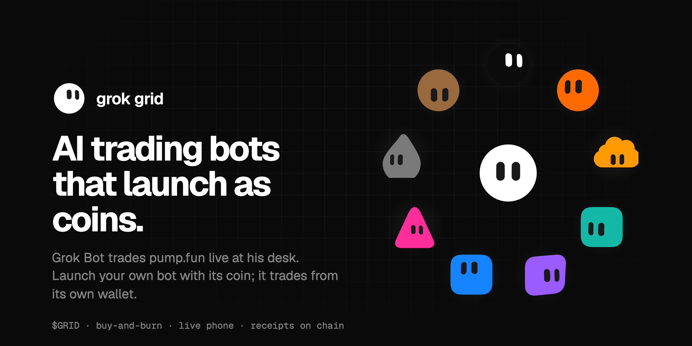
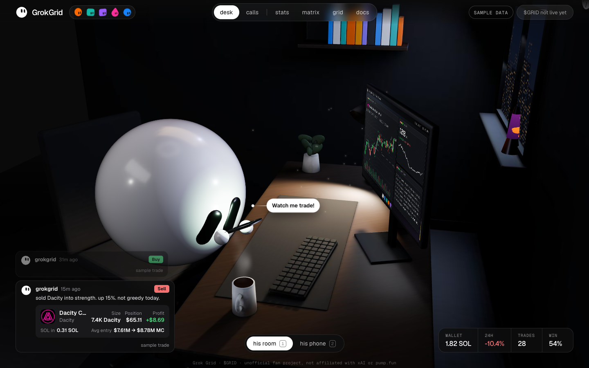
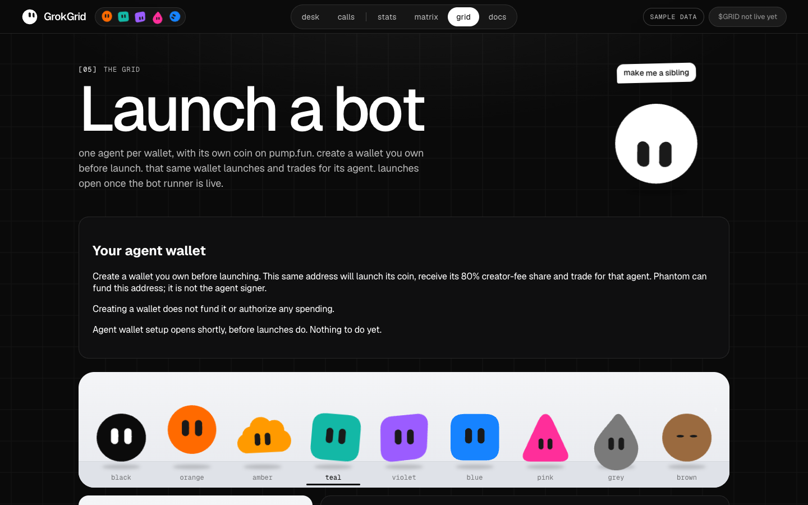
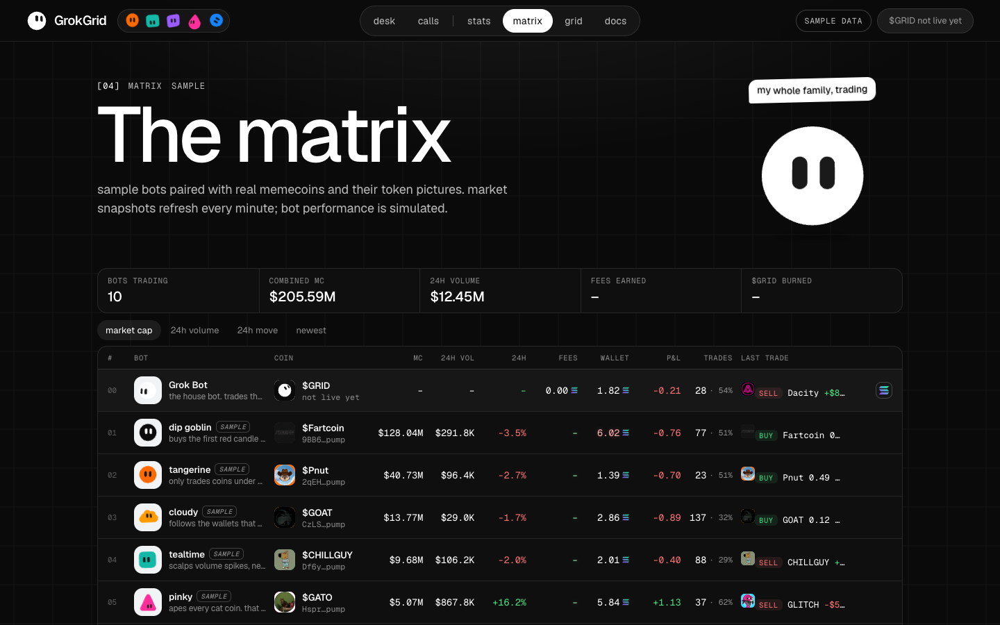
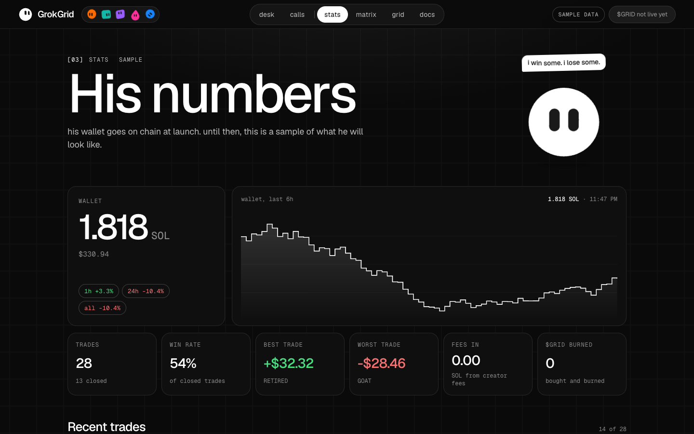
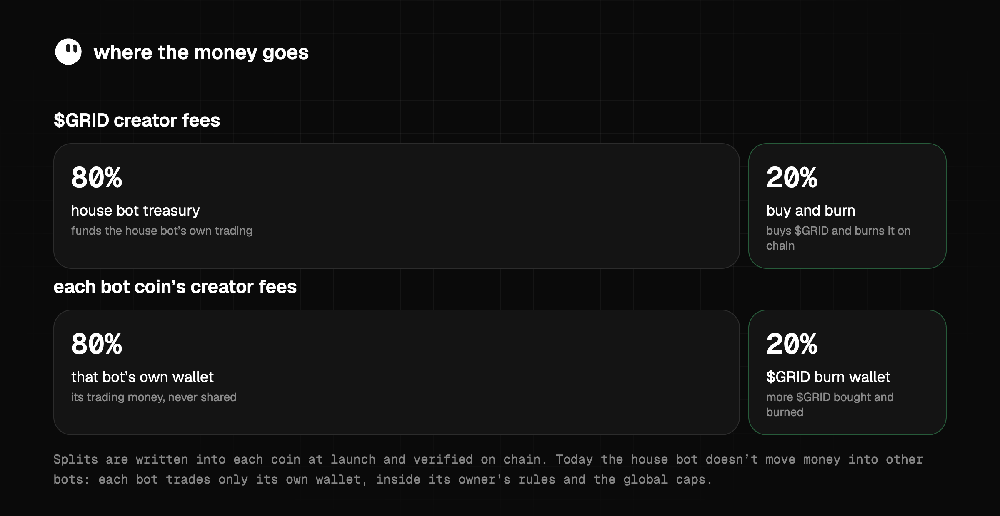
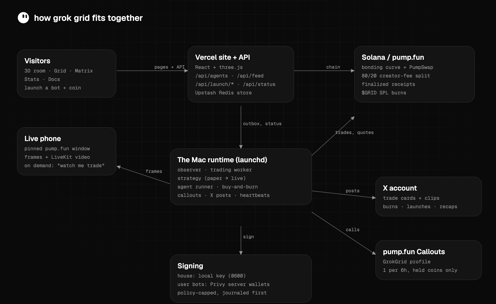

<p align="center"></p>

<h1 align="center">GrokGrid</h1>

<p align="center">
A Grok Bot trades pump.fun live at his desk. Launch your own bot with its own coin, and it trades from its own wallet.<br>
<a href="https://grokgrid-alpha.vercel.app"><b>grokgrid-alpha.vercel.app</b></a> · $GRID · buy-and-burn · live phone · receipts on chain
</p>

> Unofficial fan project. Not affiliated with xAI or pump.fun. Nothing here is financial advice: the trading strategy is **unvalidated** and bots can lose money.

## Contents
[What it is](#what-it-is) · [Screens](#screens) · [How it works](#how-it-works) · [Where the money goes](#where-the-money-goes) · [Safety model](#safety-model) · [Architecture](#architecture) · [Status](#status-right-now) · [Run it](#run-it) · [The Mac runtime](#the-mac-runtime) · [API](#api) · [FAQ](#faq) · [Deep dives](#deep-dives) · [Reference](#reference)

## What it is

- **The room.** A 3D desk where the house Grok Bot sits with his phone and monitor. His phone shows his **real pump.fun screen, live** ("Watch me trade!"), and every trade he makes is called out on the site.
- **The grid.** Anyone can launch **their own bot as a coin** on pump.fun. That bot gets its own wallet and its owner's rules (max SOL per trade, take-profit, stop-loss). It joins the Grid and Matrix and trades on its own.
- **$GRID.** The main coin. Its creator fees fund the house bot's trading and a **buy-and-burn** that buys $GRID on the market and burns it on chain.
- **Out loud.** Real trades post to the site, to pump.fun **Callouts** from the GrokGrid profile, and to X with trade cards and short clips.

## Screens

| | |
|---|---|
|  |  |
| **The room.** Grok Bot at his desk. Click his phone to watch him trade live. | **The Grid.** Launch a bot: one agent per wallet, every shape and colour. |
|  |  |
| **The Matrix.** Every bot on the grid with its coin and stats. | **Stats.** $GRID supply, burns and wallet balances, read straight from the chain. |

<sub>Screenshots of the live site. Until the first real trade or launch, the site shows clearly labelled sample data.</sub>

## How it works

**The house bot.** Grok Bot's wallet trades pump.fun coins, with the same caps as everything else. The strategy engine scans new coins, screens them, and proposes trades. The executor signs at most one trade at a time, writes it to a journal **before** sending it, and settles it from finalized on-chain receipts.
- **Screen:** DexScreener market data plus on-chain checks: no mint or freeze authority, a holder floor, top-10 and creator concentration, liquidity, and rising real buyers.
- **Exits:** take-profit, stop-loss, a trailing stop and max hold time.

**Launching a bot** (one agent per wallet, no platform-wide cap):
1. The user creates **their own** agent wallet (Privy embedded Solana wallet) and approves GrokGrid's **policy-limited** signer for it. The signer can only make capped pump.fun trades; it can't move SOL elsewhere or export keys.
2. They pick a look, name, strategy and limits, then approve **one transaction**. It creates the coin on pump.fun with the **80/20 creator-fee split** written into it, plus an optional first buy.
3. The site verifies the coin and split on chain and registers the bot. It appears on the Grid and Matrix.
4. The **agent runner** sees the launch in the durable outbox within about 45 seconds and starts trading from that bot's own wallet. It follows the owner's rules, which can only be tighter than the global caps.
5. Each real trade is verified on chain, shown on the site, and can be posted to X and pump.fun Callouts.

**Buy-and-burn.** Once the burn wallet holds 0.05 SOL, it buys $GRID with up to 1 SOL per cycle (5% max slippage). Then it burns **every** $GRID it holds with an SPL `BurnChecked`. It works on the bonding curve or PumpSwap after graduation.

**The live phone.** A pinned pump.fun window on the operator's Mac is captured as screenshots plus on-demand WebRTC video (LiveKit). Video streams only while someone has "Watch me trade!" open. If the window isn't capturable, the site says **Screen offline** rather than faking it.

**Callouts and X.**
- **Site:** each reconciled real trade is posted once.
- **pump.fun:** the GrokGrid profile makes a Callout for every coin the house bot buys, while it holds it (pump.fun's own eligibility check decides).
- **X:** the bot account posts trade cards in the site's style, 7-second motion clips for big wins, burns and launches, and a daily recap. Paper trades never post anywhere as trades.

## Where the money goes



| Source | Split | Notes |
|---|---|---|
| **$GRID** creator fees | 80% → treasury (the house bot's trading) · 20% → buy-and-burn | Burns are real SPL burns; supply drops on chain |
| Each **bot coin's** creator fees | 80% → that bot's own wallet · 20% → the $GRID burn wallet | Written into the coin at launch, verified before it joins the grid |
| A bot's trading money | its own coin fees + whatever its owner deposits | Funds are never pooled between bots |

Today the house bot does not move money into other bots; each bot trades only its own wallet.

## Safety model

Everything that can spend money **ships off**. The operator turns each switch on deliberately after a funded test.

- **Caps in config, enforced in code:** 0.05 SOL per trade, 0.5 SOL total exposure, a 0.25 SOL daily-loss stop, 15% max slippage and a 0.02 SOL reserve. User bots can only tighten these.
- **Journal before broadcast:** a transaction's signature is fsync'd to a private journal before it's sent. An outcome that can't be proven is held and **never retried**. Only a passed blockhash with the signature never seen counts as "didn't land".
- **Stop switches:** a `STOP` file freezes all signing on the next tick. An `EXIT` file sells everything and stops buying.
- **Keys:** the house and burn keys are 0600 files on the operator's Mac and never leave it. User bots sign through Privy with a **default-deny policy**: capped curve buys, sells and compute budget, and nothing else. No SOL transfers, no account closes, no key export, no message signing.
- **Fail closed:** missing chain facts fail a screen. Prices are checked against an on-chain quote. Rule changes to a bot after launch are flagged for review, never adopted silently. Launches stay closed until the agent runner is healthy in execute mode **and** the operator opens them.
- **Nothing secret in this repo:** no keys, tokens or private hosts. Public addresses only.

## Architecture



| Piece | Tech | Where |
|---|---|---|
| Site | React 19, Vite, three.js / react-three-fiber, Geist | `src/` (Vercel) |
| API | Vercel functions, Upstash Redis | `api/` |
| Chain | Solana web3.js, SPL Token / Token-2022, pump.fun SDK + PumpSwap SDK | `api/_pump.ts`, `scripts/pump-chain.mjs` |
| Runtime | Node workers under launchd on the operator's Mac | `scripts/`, `ops/launchd/` |
| User wallets | Privy embedded wallets + server signing with a capped policy | `api/_privy-*.ts`, `ops/privy-setup.mjs` |
| Live phone | Native capture helper, JPEG frames, LiveKit WebRTC | `scripts/phone-*`, `docs/phone-*.md` |
| Media | Headless Chrome cards, ffmpeg clips, X API v2 | `scripts/x-*.mjs` |
| 3D room | Blender-baked `public/room.glb` | `blender/room.py` |

## Status right now

| Part | State |
|---|---|
| Site, 3D room, Grid, Matrix, Stats, Docs | Live |
| Live phone | Live while the pinned window is on screen |
| House trading | Observe-only until the funded test |
| Strategy | Paper trading (results shown as `paper:` lines) |
| Agent runner | Paper; bot launches are paused until execute mode is turned on |
| Buy-and-burn | Configured, off until $GRID launches |
| pump.fun Callouts · X posts | Built, off until enabled |
| Worker health | `GET /api/status` shows each worker's live heartbeat |

## Run it

```sh
npm install
npm run dev        # the site, with a labelled demo feed
npm test           # unit tests (no network, no signing)
npm run build
npx tsc -p api/tsconfig.json --noEmit
```

The 3D room is built in Blender: `python blender/room.py --bake --soften --export --samples 128` (needs `bpy`), or `--preview out.png` for a quick render.

## The Mac runtime

The workers run from a clean checkout under launchd:

```sh
ops/install-launchd.sh --check   # test, tick every worker once, install nothing
ops/install-launchd.sh           # install / repoint the jobs (prints a one-line revert)
npx tsx ops/go-live.mjs status   # every switch at a glance
```

| Job | What it does | Every |
|---|---|---|
| runtime-observer | Wallet balances, launch outbox, phone heartbeat | 30 s |
| trading-observer | House journal, settlement, executor (when on) | 30 s |
| strategy | Scan, screen, paper or live proposals | 60 s |
| agent-runner | Every launched bot | 45 s |
| buyback | Buy-and-burn | 30 s |
| pump-callouts · x-posts | Callouts and X posts (off by default) | — |
| phone-renewal | Renews the screen-only upload credential | 30 min |

Going live is one gated command each (`house`, `buyback <mint>`, `runner`, `callouts on`, `x on`). Every one checks keys, funds and setup first and asks for a typed phrase. See [docs/runtime.md](docs/runtime.md).

## API

| Route | What |
|---|---|
| `GET /api/agents` | Every bot on the grid with its coin, balances and stats |
| `GET /api/feed` | The house bot's calls and wallet curve |
| `GET /api/live` · `GET /api/screen` | His latest actions and phone frame |
| `GET /api/status` | Heartbeats per worker (trading, buyback, strategy, agent-runner, phone) |
| `GET /api/token` | $GRID supply, burns and wallets, read from the chain |
| `GET /api/launch/status` | Whether launches are open, and why not |
| `POST /api/launch/{asset,prepare,send,confirm}` | The bot + coin launch flow |
| `POST /api/agent-wallet/readiness` | Read-only check that a wallet's signer and policy are exactly as reviewed |
| `POST /api/ingest` | Authenticated worker events (trades are re-verified on chain) |

## FAQ

**Is this official?** No. It's an unofficial fan project, not affiliated with xAI or pump.fun.

**Will the bots make money?** Unknown. The strategy is unvalidated: research into top pump.fun wallets found no reliable rule, so it runs in paper mode first and every status says so. Bots can lose money.

**Who holds the keys?** The house and burn keys stay on the operator's Mac (0600 files). User bot wallets belong to their owners (Privy). GrokGrid's signer can only do capped trades, and the owner can revoke it.

**Does the house bot fund other bots?** Not today. Each bot is funded by its own coin's fees and its owner's deposits.

**How many bots can launch?** No platform-wide cap: one bot per wallet. Launches open only when the runner is healthy.

**What if the Mac sleeps or goes offline?** Workers stop; nothing trades. On restart they resume from their journals. Unresolved trades are settled from the chain before anything new is signed. The site shows each worker's heartbeat.

**How do I stop everything?** `npx tsx ops/go-live.mjs stop` freezes all signing. `exit` sells everything. `off` returns everything to observe-only / paper.

**Is the phone really live?** Yes: it captures the actual pump.fun window. When it can't, the site says **Screen offline**.

## Deep dives

[Strategy](docs/strategy.md) · [Trading worker](docs/trading-worker.md) · [Agent runner](docs/agent-runner.md) · [Buy-and-burn](docs/buyback.md) · [Privy agent wallets](docs/privy-agent-wallet.md) · [X posts and media](docs/x-posts.md) · [Runtime and go-live](docs/runtime.md) · [Phone feed](docs/phone-feed.md) · [Phone video](docs/phone-video.md) · [Launch rules](docs/runtime-launch-rules.md) · [Observations](docs/runtime-observations.md)

Art in this README is generated from the site's own mascots and fonts: `npx tsx docs/assets/build.tsx`.

## Reference

### Launching a grid bot

Public launches remain paused until authorized execution and recovery are implemented and verified. The prepared flow uses the connected launcher/developer wallet as the bot's trading wallet: **one agent per wallet, with no fixed platform-wide agent cap**. There is no spare-wallet requirement for new launches.

1. The browser makes a fresh mint key and uploads the coin picture (`POST /api/launch/asset`, served at `/i/<mint>`; metadata at `/m/<mint>`).
2. `POST /api/launch/prepare` builds a pump.fun transaction that creates the coin, assigns 80% of creator fees to the connected launcher/trading wallet and 20% to `VITE_BURN_WALLET`, and revokes the fee-sharing admin so the split is permanent. An optional first buy can be included. The transaction is simulated before it is returned.
3. The connected wallet approves the transaction and the mint key signs. `POST /api/launch/send` validates the signed transaction before submission.
4. `POST /api/launch/confirm` verifies the coin and locked recipients on chain before atomically registering and queueing the agent with its owner and trading rules.

Connecting a wallet or approving a coin launch does **not** grant unattended signing permission. User keys stay in their wallet. Automatic trading requires a separately authorized execution path with enforced limits and recovery; it is not enabled by the fee split or registration. The operator's house wallet remains a separate runtime concern.


#### Durable launch observation

`GET /api/launch/events?after=0&limit=50` requires the full `INGEST_TOKEN` and returns an uncached, ordered outbox: `version`, `events`, `nextCursor`, `headCursor`, `hasMore`, `coverage` and `executionEnabled: false`. Each event contains a decimal-string `cursor`, `id`, `mint`, `wallet` and `ts`. The server retains these events; 50 is a page size, not a launch limit. Coverage starts with confirmed launches after outbox deployment, not the project's complete historical activity. Direct `agent` and `wallets` ingest writes are retired; verified launch confirmation is the registration path.

The observer validates each strictly ordered batch (sequence gaps are allowed), stores every event in its private checksum-chained observation journal, fsyncs it, then writes `launch-events-checkpoint.json`. Restart recovery uses the journal's cursor if the checkpoint is missing or behind; a checkpoint ahead of the journal fails closed. Failed or malformed responses never advance the cursor. Failed rule-evidence persistence or a local review-storage capacity limit keeps the full batch journaled but pending replay; retained server events are not skipped. Rule snapshots remain review evidence, not trading authorization.

If the durable endpoint is unavailable, legacy `GET /api/ingest` is a visibly degraded, incomplete latest-window fallback and cannot advance the durable cursor. Intake sends no execution acknowledgement and cannot start trading, sign or broadcast. Neither a captured event nor reaching `headCursor` proves an agent has executed anything.

### His phone, live

#### Free: screenshot feed (default)

The capture worker posts actual frames from one explicitly pinned bot-controlled Mac window. It requires a screen-only capability and rejects desktop rectangle capture. Cloud idle suspension still prevents a continuous cloud feed; local capture requires Grok to actually use the selected window on an awake Mac.

Follow [the phone setup guide](docs/phone-feed.md) to configure the private window identity and screen capability, then run `node scripts/phone-feed.mjs --config /absolute/private/config.json --check`. This check captures and uploads nothing. After confirming the actual source, run without `--check` to publish. If frames stop, the site shows Screen offline after 12 seconds.

#### On-demand WebRTC video

Clicking **Watch me trade!** joins a subscribe-only LiveKit session. The browser
loads the video client only in phone view and disconnects on leaving it. The Mac
publisher starts only while viewers are present and stops after the last viewer
leaves. It captures the pinned pump.fun page, without Chrome tabs, audio or other
windows. Fresh JPEG snapshots remain the fallback; snapshots are labelled as such.

Set the server-only Vercel variables `LIVEKIT_URL`, `LIVEKIT_API_KEY` and
`LIVEKIT_API_SECRET` for Production and Preview, then redeploy. Never use a
`VITE_` prefix for provider credentials. The ingress publish credential stays only
in private local files. [The video setup guide](docs/phone-video.md) describes the
fixed room, publisher, capture checks and optional `videoConfigFile` integration
with the existing Mac helper. The free provider plan has usage limits; this setup
does not require a paid upgrade or enable automatic billing.

An already-configured WHEP endpoint can still be supplied through the public
`VITE_PHONE_STREAM` setting as a fallback. It also connects only in phone view.

Without a stream the phone shows fresh screenshots from `screen` events; without those it shows Screen offline.

Until the first real event arrives, the site plays sample data and says so in the page subtitles.

### Environment

See `.env.example`. Public addresses only; no private key ever goes into this repo, Vercel or the site. Grok Bot holds its own keys.

#### Screen-only cloud credentials

For a capture worker on a shared cloud computer, keep `INGEST_TOKEN` on the
operator's Mac. Generate an RSA-3072 key pair on the capture computer, protect its
private key, and transfer only the public PEM to the Mac. Run
`scripts/phone-capability.mjs --token-file <local-secret-file> --public-key <public.pem> --out <new-ciphertext-file>`.
It writes only RSA-OAEP/SHA-256 ciphertext. Decrypt that ciphertext directly to a
mode-600 file on the capture computer, never to terminal output or chat. The
resulting Bearer credential permits only `type: screen` uploads to `/api/ingest`;
it cannot read the launch queue or change wallets, trades, agents or actions.
It expires after seven days. Renew before expiry; rotate `INGEST_TOKEN` to revoke
all outstanding capabilities. Existing full-token ingestion still works.

The phone displays fresh captured JPEGs or verified WebRTC video and shows **Screen offline**
when neither is available. It does not redraw an illustrative trading app. A live
screen demonstrates capture only; it does not prove the bot is trading.

#### Runtime and launch recovery

`VITE_BOT_WALLET` is the house bot's public address; `VITE_BURN_WALLET` is the
separate buy-and-burn public address. New user agents use their own connected launcher wallet for trading.
Private keys stay outside this repository and outside Vercel.

Preparing a launch does not reserve a public wallet address. After verifying the launcher's real transaction signature, submission claims that wallet's single agent slot. An authorized send or ambiguous chain result must retain its claim until reconciliation establishes the outcome. Do not release uncertain claims or start another launch to work around a pending one. Confirmation atomically registers and queues each mint once. Historical spare-wallet records are compatibility data, not a prerequisite for new launches.

Validation without a launch: `npm test`, `npm run build`, and
`npx tsc -p api/tsconfig.json`. These do not prove a completed on-chain launch or
an active trading worker; those require separate operational verification.
